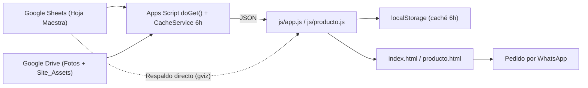

# Proceso de Funcionamiento — NAMNA Fine Jewelry

> Documento técnico que explica **cómo funciona la web de punta a punta**.
> Para el historial de cambios ver [CHANGELOG.md](CHANGELOG.md). Para el estado y pendientes ver [ESTATUS_Y_MEJORAS.md](ESTATUS_Y_MEJORAS.md).

---

## 1. Arquitectura general



| Capa | Tecnología | Archivo(s) |
|---|---|---|
| Base de datos / panel del negocio | Google Sheets | `MASTER_SHEET_ID` |
| Repositorio de imágenes | Google Drive | `DRIVE_FOLDER_ID`, carpeta `Site_Assets` |
| Backend / API | Google Apps Script | `servidor_google_apps_script.js` |
| Frontend | HTML + CSS + JS vanilla | `index.html`, `producto.html`, `info.html`, `privacidad.html` |
| Lógica cliente | JS | `js/app.js`, `js/producto.js`, `js/shield.js` |
| Estilos | CSS | `css/styles.css`, `css/wishlist_search.css` |
| Herramientas internas | HTML | `admin.html`, `generador-seo.html` |
| SEO / IA | Texto / XML | `robots.txt`, `sitemap.xml`, `llms.txt`, `llms-full.txt` |

---

## 2. Flujo del operador (cómo se gestiona el catálogo)

1. **Añadir/editar producto** → se edita una fila en la Hoja Maestra (primera pestaña).
   - Columnas críticas obligatorias: `ID_Producto`, `Precio_Publico`, `Visible`.
   - Opcionales: `Nombre`, `Descripción ES/EN`, `Categoría ES/EN`, `Stock`.
   - `Visible` acepta: `sí, si, true, 1, yes, s, y, ok`.
2. **Subir fotos** → a la carpeta de Drive, nombrando el archivo con el `ID_Producto`
   (las fotos "hijas" forman la galería del producto).
3. **Imágenes decorativas** (hero, banners) → carpeta `Site_Assets` en Drive.
4. **Textos de la web** → pestaña de textos de la Hoja (leída por `leerTextos()`).
5. **Publicar cambios al instante** → `admin.html` → botón *Refrescar caché del servidor*
   (llama `?action=invalidate`). Si no, los cambios aparecen en máx. 6 h.

### Utilidades del Apps Script (se ejecutan desde el editor)
| Función | Uso |
|---|---|
| `invalidarCacheManual()` | Limpia la caché del servidor |
| `autoCategorizar()` | Rellena categorías automáticamente |
| `inyectarTextosIngles()` | Carga en lote los textos EN de la web |
| `inyectarTraduccionesProductos()` | Traduce descripciones de productos |

---

## 3. Flujo del servidor (`doGet`)

1. Si `?action=invalidate` → borra caché y responde OK.
2. Si no hay `?refresh=true` → intenta responder desde **CacheService** (< 500 ms).
3. Si no hay caché:
   - Abre la hoja con `openById()`, valida columnas críticas.
   - Obtiene el **mapa de fotos** de Drive (también cacheado).
   - Filtra productos visibles y construye URLs CDN de imágenes.
   - Lee textos e imágenes del sitio.
   - Guarda la respuesta en caché (dividida en trozos de < 100 KB) y la devuelve.

---

## 4. Flujo del navegador (`js/app.js`)

1. **Arranque**: tracking opcional (GA / Meta Pixel), idioma (`namna_lang`, por defecto EN), wishlist.
2. **Carga del catálogo** (estrategia *stale-while-revalidate*):
   - Si hay caché en `localStorage` (`namna_catalog`, < 6 h) → pinta al instante y refresca en segundo plano.
   - Si no → `fetchFromAppsScript()` → si falla, `fetchFromGoogleSheets()` (respaldo directo) → si falla, imágenes *fallback* de `assets/`.
3. **Render**: skeletons → filtros por categoría → tarjetas → sección "Nuevos" → JSON‑LD de productos (SEO).
4. **Interacción**: modal de producto, buscador a pantalla completa, favoritos, cambio de idioma sin recarga, menú móvil.
5. **Conversión**: botón **WhatsApp** (`34695261649`) con mensaje prellenado; también pedido del carrito de favoritos.
6. **Producto individual**: `producto.html?id=XXX` usa `js/producto.js` con la misma lógica de carga.

---

## 5. Seguridad aplicada
- `shield.js`: bloqueo de clic derecho, selección, atajos, arrastre, detección DevTools, anti‑iframe.
- Precios y credenciales se procesan en Apps Script; el navegador solo recibe datos públicos.
- `admin.html` con `noindex` y bloqueado en `robots.txt` + contraseña en cliente (ver mejoras).

---

## 6. Desarrollo local y despliegue
```bash
npm install
npm start        # npx serve .  → http://localhost:3000
```
- **Frontend**: sitio estático (cualquier hosting estático).
- **Backend**: pegar `servidor_google_apps_script.js` en Apps Script → *Implementar → Aplicación web* (acceso: cualquiera) → copiar la URL en `CONFIG.APPS_SCRIPT_URL` de `js/app.js`, `js/producto.js` y `admin.html`.
- Cada cambio debe registrarse en `CHANGELOG.md`.
